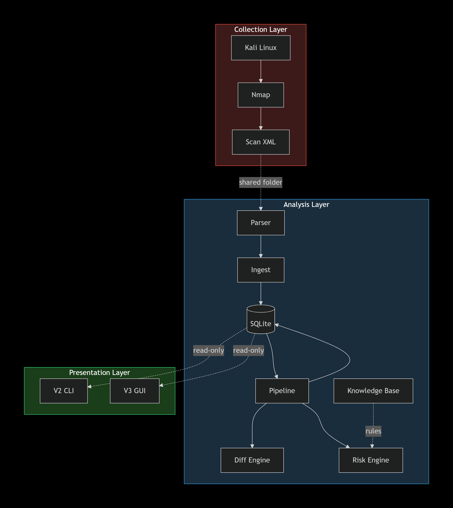
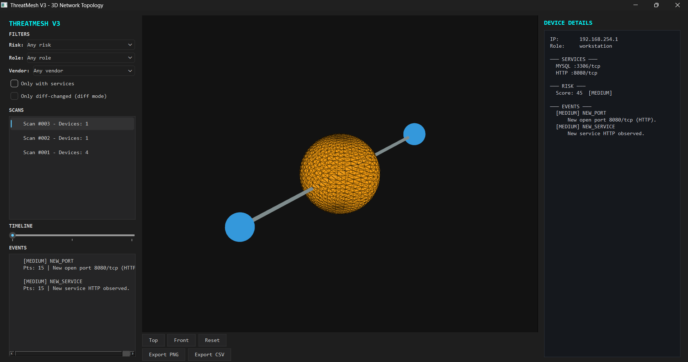
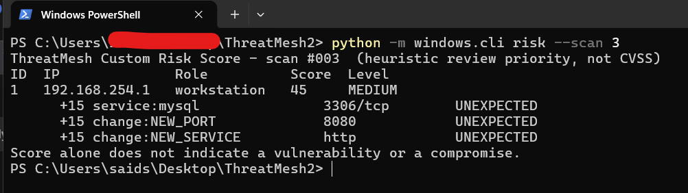
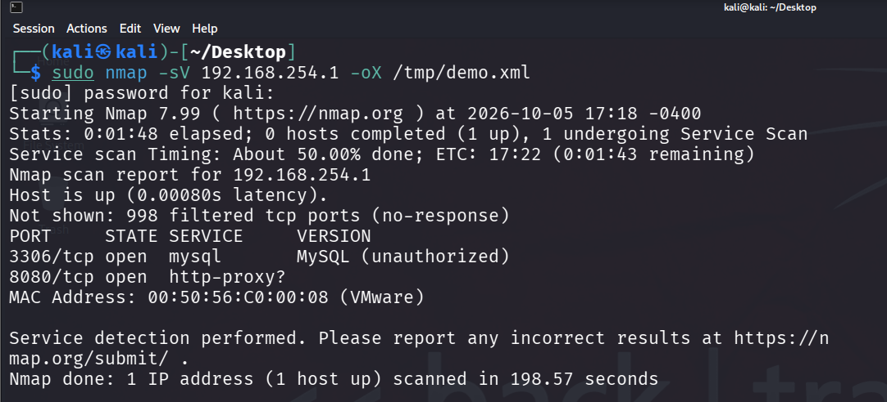

# ThreatMesh

**Network monitoring and analysis toolkit with a 3D visualization GUI.**

ThreatMesh collects network scan data from Nmap, analyzes changes between scans, assigns context-aware risk scores, and visualizes the network as an interactive 3D topology.



---

## Table of Contents

- [What it does](#what-it-does)
- [Architecture](#architecture)
- [Features](#features)
- [Screenshots](#screenshots)
- [Requirements](#requirements)
- [Setup](#setup)
- [Usage](#usage)
- [Testing](#testing)
- [Disclaimer](#disclaimer)
- [License](#license)

---

## What it does

ThreatMesh is a three-layer pipeline:

1. **Collection** — Kali Linux runs Nmap scans, producing XML files
2. **Analysis** — Python backend parses XMLs, diffs consecutive scans, and computes context-aware risk scores
3. **Presentation** — a CLI for quick inspection and a PySide6 + PyVista GUI for interactive 3D topology visualization

All layers share a single SQLite database. The GUI is read-only — it never writes to the analysis database.

---

## Architecture

See the [full architecture diagram](docs/screenshots/architecture.png) for a detailed view of every component and data flow.

---

## Features

### V1 — Data collection
- Nmap XML parser (structured, not regex)
- Device identity resolution — MAC-first, IP fallback
- SQLite schema with forward-only migrations
- Idempotent ingest (SHA-256 file hash)
- Sidecar JSON metadata (sensor ID, profile, mode, targets)

### V2 — Analysis engine
- **Diff engine** — detects new/closed ports, new/removed services, version changes, IP changes, devices going offline
- **Context-aware risk scoring** — the same port scores differently depending on the device role:
  - `EXPECTED` (0.25× multiplier) — service is normal for this role
  - `UNKNOWN` (1.0×) — no role assigned
  - `UNEXPECTED` (1.5×) — service is unusual for this role
- **Knowledge base** — services, roles, and finding templates as JSON. No AI in the analysis loop — deterministic rules only
- **7-field explanations** — every finding comes with *what happened*, *why it matters*, *how it was detected*, *recommended state*, *investigate*, *do not*, *mitigation*
- **24 unit tests**, all passing

### V3 — 3D visualization
- PySide6 + PyVista interactive 3D network topology
- Risk-colored device spheres (LOW → MEDIUM → HIGH → CRITICAL)
- Service nodes connected to their host device
- Click a device node to see details (services, risk factors, events)
- Timeline slider to navigate between scans
- Filter panel (risk level, role, vendor, has-services)
- Camera presets (Top / Front / Reset)
- Export as PNG screenshot and CSV data
- Dark theme, monospace typography

---

## Screenshots

### 3D Topology — V3 GUI



*Scan #003 selected. A single device with MySQL (3306) and HTTP (8080) services exposed. Risk score 45 MEDIUM, driven by three UNEXPECTED-context factors. The right panel shows the full breakdown.*

### CLI — Risk Scoring Output



*`python -m windows.cli risk --scan 3` — heuristic review priority, not CVSS. Each factor is listed with its expectation context.*

### Scan Collection — Kali + Nmap



*`nmap -sV 192.168.254.1` running on Kali. The XML output feeds directly into the ThreatMesh ingest pipeline via a VMware shared folder.*

---

## Requirements

- **Python 3.11+**
- **PyYAML** — for config and rules parsing
- **PySide6** — for the V3 GUI
- **PyVista** + **PyVistaQt** — for 3D rendering

See `requirements.txt`.

---

## Setup

```bash
git clone <repo-url>
cd ThreatMesh2
pip install -r requirements.txt
python -m windows.cli init
```

---

## Usage

### CLI (V2)

```bash
# Ingest all XML files from data/incoming/
python -m windows.cli ingest

# List all scans
python -m windows.cli scans

# List all devices observed across scans
python -m windows.cli devices

# Show events for a specific scan
python -m windows.cli events --scan 3

# Show risk scores for a specific scan
python -m windows.cli risk --scan 3

# Show a 7-field explanation for an event
python -m windows.cli explain 14

# Assign a role to a device (affects risk scoring context)
python -m windows.cli set-role 192.168.254.1 workstation

# Re-analyze a scan (deletes and regenerates events)
python -m windows.cli analyze --scan 3 --force
```

### GUI (V3)

```bash
python -m v3.main
```

The GUI opens with the most recent scan selected. Click any device sphere in the 3D view to see its details in the right panel.

### Scan collection (Kali side)

```bash
sudo python3 kali/nmap_scanner.py --profile home_hotspot --mode services
```

Scope validation runs first — the profile must have `authorized: true` in `config/scope.yaml`.

---

## Testing

```bash
python -m unittest discover -s tests -t . -v
```

Expected output: `Ran 24 tests` → `OK`.

---

## Disclaimer

ThreatMesh is designed for scanning networks you own or have **written authorization** to test. The scope validation in `kali/nmap_scanner.py` enforces this: scans cannot run against a profile that does not have `authorized: true` in `config/scope.yaml`.

The **Custom Risk Score is a heuristic review priority indicator, not a CVSS score.** A high score does not mean a vulnerability exists. A low score does not mean a device is safe. Findings are observations, not verdicts.

---

## License

MIT — see [LICENSE](LICENSE).

## Legal Notice

**ThreatMesh is designed for scanning networks you own or have explicit
written authorization to test.** All example data in this repository
uses private IP ranges (RFC 1918) from a self-owned lab environment.

The **Custom Risk Score is a heuristic review priority indicator, not a
CVSS score.** A high score does not mean a vulnerability exists. A low
score does not mean a device is safe. Findings are observations, not
verdicts.

### Finland

Unauthorized network scanning may constitute **tietomurto** (computer
break-in) under **Rikoslaki (Criminal Code of Finland), Chapter 38,
Section 8**. This provision criminalizes unauthorized access to
information systems and carries penalties of fines or imprisonment up
to two years. Attempted unauthorized access is also punishable under
Chapter 38, Section 9.

Port scanning and service enumeration without the network owner's
consent can be interpreted as attempted unauthorized access,
particularly when followed by authentication attempts, exploitation,
or data extraction.

### European Union

**GDPR (Regulation (EU) 2016/679)** applies to the processing of
personal data. IP addresses and MAC addresses are considered personal
data under EU law (see CJEU Case C-582/14, *Breyer v. Germany*).
Collecting, storing, or processing such data without a lawful basis
under Article 6 — such as consent, legitimate interest, or legal
obligation — may constitute a GDPR violation.

**Directive 2013/40/EU** on attacks against information systems
requires member states to criminalize illegal access to information
systems. Finland has implemented this directive through the amendments
to Rikoslaki Chapter 38.

### User Responsibility

By using this software, you confirm that:

- You own the network being scanned, **or**
- You have obtained explicit, documented, written authorization from
  the network owner, **or**
- You are operating in a lawful capacity (e.g., authorized penetration
  test, security audit, academic research with ethical approval)

The author of this software assumes no liability for misuse. Users are
solely responsible for complying with all applicable local, national,
and international laws.